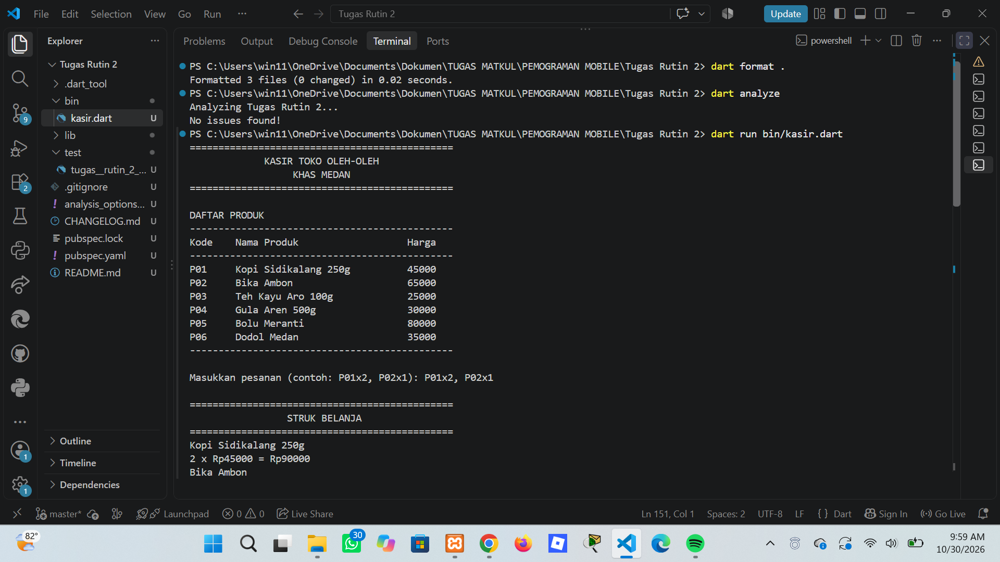
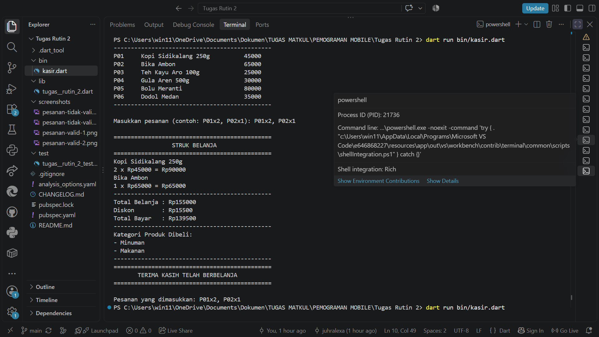
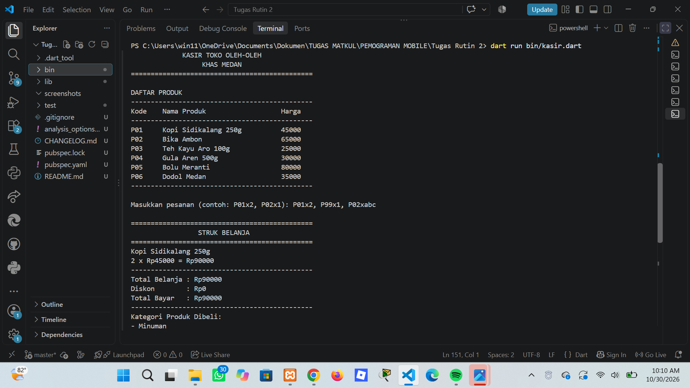
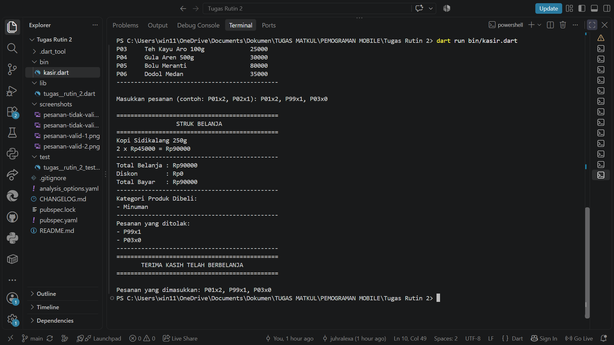

# Aplikasi Kasir Toko Oleh-Oleh Khas Medan

## Identitas Mahasiswa

- **Nama:** Juhraini Helfiana Lexa
- **NIM:** 4243550018
- **Kelas:** PSIK 24C
- **Mata Kuliah:** Pemrograman Mobile

## Deskripsi

Program ini merupakan aplikasi kasir berbasis console yang dibuat menggunakan bahasa pemrograman Dart. Aplikasi digunakan untuk membantu proses transaksi pada toko oleh-oleh khas Medan, mulai dari menampilkan katalog produk, menerima pesanan pelanggan, menghitung total belanja, memberikan diskon, hingga menampilkan struk pembayaran.

## Fitur Program

1. Menampilkan katalog enam produk oleh-oleh khas Medan.
2. Menerima pesanan dengan format `P01x2, P02x1`.
3. Memeriksa kode produk dan jumlah pesanan.
4. Menolak kode produk yang tidak tersedia atau jumlah yang tidak valid.
5. Menghitung subtotal setiap produk dan total belanja.
6. Memberikan diskon 10% jika total belanja minimal Rp100.000.
7. Menampilkan kategori produk yang dibeli menggunakan `Set`.
8. Menampilkan struk pembayaran.

## Cara Menjalankan Program

Pastikan Dart SDK sudah terpasang. Buka terminal pada folder proyek, kemudian jalankan:

```bash
dart pub get
dart format .
dart analyze
dart run bin/kasir.dart
```

## Bukti Pengujian

### 1. Pengujian Pesanan Valid

Pesanan yang digunakan: `P01x2, P02x1`.

Hasil yang diharapkan:
- Total belanja: Rp155.000
- Diskon: Rp15.500
- Total bayar: Rp139.500

Bukti screenshot:




### 2. Pengujian Pesanan Tidak Valid

Pesanan yang digunakan: `P01x2, P99x1, P02xabc`.

Hasil yang diharapkan:
- `P01x2` berhasil diproses.
- `P99x1` ditolak karena kode produk tidak tersedia.
- `P02xabc` ditolak karena jumlah bukan angka.
- Program tetap berjalan tanpa mengalami error.

Bukti screenshot:




## Penjelasan Konsep Dart dan Null Safety

Dalam Dart, `var` digunakan untuk mendeklarasikan variabel dengan tipe data yang disimpulkan secara otomatis dari nilai awalnya. `final` digunakan ketika nilai variabel hanya boleh ditetapkan satu kali, sedangkan `const` digunakan untuk nilai konstan yang sudah diketahui saat kompilasi. Pada program ini, `final` digunakan untuk variabel seperti `katalog`, `inputPesanan`, `keranjang`, dan `totalBelanja` di dalam file `bin/kasir.dart`. Program tidak menggunakan `var` dan `const` karena deklarasi yang digunakan sudah cukup dengan `final` dan nilai yang tersedia. Null safety diterapkan pada pembacaan input melalui `stdin.readLineSync() ?? ''`, sehingga apabila input bernilai null, program menggunakan string kosong. Selain itu, `int.tryParse()` menghasilkan nilai nullable yang diperiksa terlebih dahulu sebelum digunakan. Dengan demikian, program dapat menangani input yang tidak sesuai tanpa menyebabkan program berhenti karena kesalahan konversi.

## Penggunaan AI

Dalam pengerjaan tugas ini, ChatGPT digunakan sebagai alat bantu untuk memahami instruksi, memberikan arahan penyusunan kode, membantu pemeriksaan kesalahan, dan menjelaskan konsep Dart. Kode program tetap diperiksa dan dijalankan kembali oleh mahasiswa melalui Visual Studio Code menggunakan perintah `dart format .`, `dart analyze`, serta pengujian langsung pada aplikasi.

